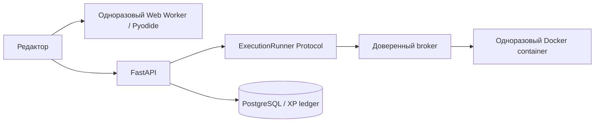

# Архитектура Python Lab

## Объём первой версии

Рабочая учебная система для уровней 0–2 и полный каталог уровней 0–11. На опубликованную тему приходятся теория, 12 примеров, 8 задач и 32 вопроса. Продвинутые темы отображаются как программа будущего наполнения, не открывают несуществующие уроки и не учитываются в знаменателе прогресса.

Следующие расширения пока не выдаются за готовые возможности: экзамены уровня с expert-вопросами, SQL/API-песочницы, интерфейс преподавателя, доставка писем для сброса пароля, загрузка аватаров, удаление аккаунта/работы пользователем, автоматическая проверка качества проектов и планировщик интервального повторения. Для проектов работает ручное подтверждение администратором через защищённый API.

## Исследование и версии

Технический reference — соседний `C:\web\my-songs-site` (MaxMusic), подтверждённый пользователем. Изучены App Router, layout, навигация, модель сессии и слой API. Дизайн создан самостоятельно: техническая типографика, графитовые поверхности, жёлтый акцент и контекстные цвета Python.

Frontend создан официальным `create-next-app` сразу с TypeScript, ESLint, App Router, `src/` и alias `@/*`. Версии проверялись по официальным документациям и registry перед инициализацией; документация установленного Next.js использовалась при реализации маршрутов и сборки.

Основной стек: Next.js 16.4.0, React 19.3.0, Python 3.14, FastAPI 0.143.0, Pydantic 2.14.1, SQLAlchemy 2.1.4, Alembic 1.20.0, PostgreSQL 18.6, Node.js 24. Motion отвечает за анимацию, TanStack Query — за server state. Pyodide 314.0.7 закреплён точно, потому что worker и пакет runtime должны совпадать.

TypeScript 5.9 и ESLint 9 выбраны по совместимости инструментов: генератор OpenAPI требует TypeScript 5, а установленный набор ESLint-плагинов Next.js несовместим с ESLint 10. Это осознанное ограничение dev-инструментов; обновлять их нужно вместе с зависимыми пакетами. Основные runtime-зависимости закреплены lock-файлами.

## Frontend и FSD

```text
src/app           App Router, metadata, providers, styles
  ↓
src/views         композиция страниц
  ↓
src/widgets       layout, lesson navigation, editor, quiz, dashboard
  ↓
src/features      действия: auth, complete, submit, execute, profile
  ↓
src/entities      query definitions и типы доменных сущностей
  ↓
src/shared        API transport, generated contract, UI primitives
```

Слой страниц называется `views`: каталог `src/pages` резервируется Next.js для Pages Router и конфликтует с такой структурой App Router. Это адаптация физического имени FSD-слоя, его ответственность и правила зависимостей сохранены. `src/app/**/page.tsx` остаются тонкими точками композиции.

Каждый slice экспортирует публичный API через `index.ts`/`index.tsx`. Между slices одного слоя нет импортов; нижние слои не импортируют верхние. `scripts/check-fsd.mjs` проверяет импорты, публичные API и циклы через TypeScript AST. Результат контролируется CI.

Server Components используются для корневого layout, metadata, маршрутов и статической композиции. Кабинет объединён route group `app/(lab)` с одним постоянным layout: страницы содержат только контент, боковая панель и хедер не монтируются повторно при переключении вкладок. Общий `loading.tsx` удалён, чтобы навигация не подменяла сохранённые данные промежуточным скелетоном. Скелетоны отображаются в страницах только до получения необходимых данных; фоновое обновление сохраняет уже загруженный контент.

TanStack Query хранит API-данные и снимок сессии. `shared/api/query-client.ts` задаёт общую политику; `entities` экспортируют типизированные `queryOptions` с `AbortSignal`. Учебный контент актуален 15 минут, личные данные — минуту; неиспользуемые запросы удаляются через 15 минут. Приватные ключи включают ID пользователя и не запрашиваются до восстановления сессии. Серверные действия используют мутации с адресной инвалидацией прогресса, достижений и профиля. Вкладки, редактор, ответы и подсказки остаются локальным UI-состоянием.

При выходе транспорт блокирует refresh и прерывает запросы предыдущей сессии, затем AuthProvider отменяет query и полностью очищает QueryClient, включая mutation cache. Очистка повторяется в `finally`, даже при ошибке logout API. В новом кэше остаётся только снимок гостевой сессии `null`; смена ревизии повторно подключает наблюдатель сессии после `clear()`. Поздние HTTP-ответы проверяют версию сессии и не могут вернуть прежний токен или данные. Вход также очищает предыдущий кэш и устанавливает снимок нового пользователя. Кэш остаётся в памяти; API-транспорт использует `cache: "no-store"`, а тела POST клонируются для повтора после refresh.

Глобальный store не нужен. Strict TypeScript и `noUncheckedIndexedAccess` проверяют обращения к коллекциям; внешние сообщения worker принимаются через runtime type guards. Регрессии покрывают переходы с заполненным кэшем, постоянство layout, logout при ошибке сервера и поздних ответах, повтор POST после refresh и очистку query/mutation cache.

Генерируемый `shared/api/schema.ts` строится из `backend/openapi.json`. Все вызовы проходят через `openapi-fetch` и `unwrap`; бизнес-компоненты не создают разрозненные fetch-клиенты. 401 вызывает одну общую попытку refresh, включая StrictMode. Выбор темы сохраняется в localStorage; токены туда не помещаются.

## Backend

```text
api/routes + dependencies  HTTP, auth/role guards, transaction scope
schemas                    валидация запросов и формы ответов
services                   auth, grading, execution, progress
domain                     чистые правила выбора вопросов, XP/streak/percent
repositories               SQL-запросы каталога
models                     SQLAlchemy persistence
core                       settings, database, security
content                    авторский учебный материал и построение банка
```

Типы включают SQLAlchemy `Mapped[T]`, строгие Pydantic-схемы, `Annotated` dependencies, точные типы коллекций и `Protocol` исполнителя. Mypy работает в strict mode с плагином Pydantic. Зависимость от конкретного runner внедряется через FastAPI Depends; tests заменяют её на отключённый исполнитель.

База используется асинхронно через asyncpg и SQLAlchemy AsyncSession. Дорогая проверка и хеширование пароля вынесены из event loop в поток. Вход и смена пароля сериализуются блокировкой строки пользователя, чтобы вход со старым паролем не пересёк отзыв сессий.

`get_session` задаёт транзакцию на запрос; dependency имеет `scope="function"`, чтобы commit произошёл до отправки ответа. Конфликты уникальности превращаются в 409 без выдачи деталей SQL. API не принимает вычисленный клиентом XP, score, role или правильные ответы.

## Данные и прогресс

Основные связи: Course → Level → Module → Topic → Lesson / Exercise / Question / Quiz. ExerciseTest хранит серверный stdin/output. QuizAttempt принадлежит пользователю, содержит случайный порядок question IDs и время начала; Answer хранит выбранные индексы и серверную оценку. ProjectSubmission отделён от Project и требует одобрения. Есть AuthSession, PasswordResetToken, QuestionMemory и UserAchievement.

Используются UUID для пользовательских записей, стабильные slug IDs для авторского контента, foreign keys, unique/check constraints, timestamps и индексы. Миграция Alembic — единственный путь изменения рабочей схемы; приложение не запускает `create_all` при старте.

Completion — журнал подтверждённых учебных событий, уникальный по `(user_id, kind, resource_id)`. Параллельные начисления сначала блокируют User через `FOR UPDATE`, затем проверяют журнал, меняют XP/серию и создают событие в одной транзакции. Повторный запрос возвращает 0 нового XP. Это проверяется пятью одновременными запросами на PostgreSQL.

Отдельные таблицы LessonProgress/TopicProgress/LevelProgress/CourseProgress не дублируют один факт в четырёх местах: read model рассчитывается из журнала. Теория даёт 20 XP, задача — 30 XP, первый зачёт теста — 50 XP при результате ≥70%, подтверждённый проект — 500 XP. Тема считается закреплённой после теории, всех задач и зачёта теста. `current_level` пользователя — ранг XP, а Level каталога — ступень учебной программы; это разные значения.

Серия и дневная цель учитывают IANA timezone пользователя. Повторное прохождение не создаёт фиктивную активность. Read model сбрасывает отображаемую серию при пропуске дней. Слабые темы определяются по сохранённым неверным ответам, а не захардкоженными рекомендациями. QuestionMemory сохраняет correct/wrong counts, confidence и next_review для будущего spaced repetition.

Seed обновляет записи по стабильным IDs и не очищает пользовательские таблицы. Перед публикацией изменения банка должны вводиться как новая версия вопросов: существующие question IDs нельзя переиспользовать для другого задания или другого правильного ответа, потому что история попыток ссылается на эти записи. Для редакторского workflow следующая итерация должна добавить immutable snapshots/versioned publishing; автоматический seed текущей версии безопасен при неизменном банке.

## Сессия и авторизация

Access JWT: 15 минут, HS256 с явным allowlist, issuer, audience, exp и типом токена. В JWT только идентификаторы. Access token живёт в памяти браузера. Как в MaxMusic, транспорт объединяет обновление токена в один запрос, повторяет исходный запрос только один раз и восстанавливает сессию после перезагрузки через HttpOnly cookie. Refresh — случайный opaque token с абсолютным сроком сессии 30 дней; БД хранит только SHA-256 digests, а браузер — HttpOnly, SameSite=Strict cookie с путём `/api/auth`.

Rotation блокирует AuthSession по стабильному ID, записывает использованный digest в UsedRefreshToken и заменяет текущий. Повтор использованного refresh отзывает всю связанную сессию, включая действующий access JWT; другие устройства сохраняют собственные сессии. Ответ 401 возвращается без исключения, чтобы транзакция сохранила отзыв. Миграция `18af27c94312` добавляет историю без сброса существующих сессий. Удаление истёкших AuthSession при обслуживании БД каскадно удаляет историю digests.

Web Locks сериализуют refresh и logout между вкладками одного origin, предотвращая случайную повторную отправку использованного cookie. BroadcastChannel передаёт только событие выхода: каждая вкладка отменяет запросы и очищает кэш. Данные пользователя и токены через канал не передаются. Истечение сессии также очищает UI и кэш; сетевой сбой не считается подтверждённым отзывом. Logout сохраняет предыдущий access только до запроса отзыва, чтобы сервер нашёл сессию при одновременной rotation cookie. Даже при ошибке logout локальные query/mutation caches очищены; серверный отзыв требует доступного API.

Каждый защищённый API-запрос проверяет существование пользователя и активной серверной сессии. Выход и смена пароля отзывают сессию сразу, не ожидая истечения JWT. Admin guard проверяет роль на сервере. Чужая попытка теста недоступна даже при известном UUID.

Cookie-операции проверяют точный Origin; CORS разрешает только заданный origin. Header Bearer API не использует cookies как самостоятельную авторизацию. В production конфигурация требует HTTPS origin и Secure cookies, отключает Swagger/ReDoc/OpenAPI endpoints и проверяет Host. Документация генерируется отдельно для контракта.

Локальный лимитер авторизации ограничивает 30 операций в минуту на адрес процесса и ограничивает память 10 000 ключами. Это вспомогательный предел. Публичный gateway должен ограничивать запросы независимо от числа API workers и правильно определять IP клиента; настройки приведены в [deploy/nginx.conf.example](deploy/nginx.conf.example).

## Выполнение Python



Браузерный worker — удобный пробный запуск на устройстве пользователя, не доверенный grader. Runtime self-hosted, исполняется в module worker и загружается через динамический import внутри обработчика для совместимости с CSP в Chromium, Firefox и WebKit. Загрузка ограничена 45 секундами, выполнение — 5 секундами, вывод — 16 КБ; остановка завершает worker. CSP ответа worker разрешает загрузку только runtime-ресурсов, запрещает обращения к API и внешней сети и создание дочерних workers. Обёртка fetch даёт понятное сообщение о запрещённой сети; границей изоляции остаётся CSP. Реальный браузерный тест подтверждает запрет `js.fetch('/api/health')`. Web Worker не даёт гарантированного лимита памяти устройства: большие выделения памяти нельзя считать надёжно изолированными средствами этой версии браузерного runtime.

API никогда не вызывает `exec` для пользовательского кода. Проверка отправляет исходный код и серверные тесты доверенному broker по закрытой сети с Bearer token. При отключённом/недоступном runner — 503 и отсутствие XP.

Broker запускает Docker без shell interpolation, с read-only FS, без сети, UID 65534, без capabilities, с no-new-privileges, лимитами 128 МБ RAM, 0.5 CPU, 32 процессов, файловых дескрипторов и общего вывода stdout/stderr 16 КБ. `/tmp` — ограниченный tmpfs. Stdin задаётся внутри контейнера через TextIOWrapper; Python bootstrap исполняет программу только там. На запуск контейнера даётся 10 секунд, на пользовательский код — отдельные 5 секунд после доверенного маркера готовности. После каждого теста контейнер удаляется, включая timeout и отмену. Broker допускает четыре работы одновременно; ожидающие сверх лимита получают отказ. Для максимум восьми кейсов таймаут ответа API составляет 150 секунд, Next.js и gateway — 180 секунд; это не увеличивает лимит выполнения кода.

Compose-профиль `sandbox` использует отдельный Docker-in-Docker daemon. Host Docker socket не монтируется ни в API, ни в runner. DinD требует privileged и остаётся доверенной инфраструктурой. Для публичного запуска исполнение следует вынести на отдельную VM/хост с sandbox kernel/runtime и квотами пользователя: обычный Docker не является доказанной защитой от всех kernel exploits. Песочница не должна соседствовать с секретами и БД публичного production.

Текущий grader проверяет stdout/exit status, не стиль программирования. Практика использует задания code_writing и code_completion; автоматический rubric для качества кода и многокейсные property-based проверки остаются отдельным расширением. Заготовки содержат только исходные данные, импорты и незаполненные функции. API формирует их заново и для старых записей базы, чтобы готовое решение не попадало в редактор. Все 120 заготовок проверяются запуском: их вывод не должен совпадать с ожидаемым ответом. Решения и правильные ответы не возвращаются до соответствующей серверной проверки теста.

## Проверки и воспроизводимость

Backend-тесты запускают все 180 авторских примеров, проверяют уникальность банков и распределение сложности, правила серии, auth rotation/revocation, ownership, скрытые ответы, idempotency, ошибки ввода, проекты и конкурентный XP. Docker-тесты выполняют stdin, бесконечный цикл, большой вывод, запрет сети и записи. E2E проверяет сохранение сессии, редактор, реальный grader, повторный XP, тест/разбор, прогресс, достижения, профиль и вход/выход.

Auth-регрессии проверяют подпись и обязательные JWT claims, конкурентную rotation и отзыв при replay на PostgreSQL, logout с уже использованным cookie, независимость устройств, очистку cookie и кэша, поздние ответы и синхронизацию выхода между вкладками. Гостевой bootstrap не отменяет ожидающий вход; переход после logout дожидается запроса отзыва. Браузерный fixture выдерживает интервал между auth-запросами, чтобы полный прогон соблюдал действующий лимит API без отключения защиты.

Responsive проверяется при ширине 1440/390/320 px, включая длинное имя пользователя и завершённый курс. Постоянный E2E-прогон выполняется в Chromium, Firefox и WebKit. Axe запускает WCAG A/AA проверки в обеих темах с reduced motion. Питон рисуется на Canvas после монтирования: SSR-разметка остаётся одинаковой при любых настройках движения. Его слой ограничен нижним краем блока статистики и проходит поверх фона карточек, под текстом и кнопками. ResizeObserver обновляет границы при изменении размеров; анимация приостанавливается при reduced motion, скрытой вкладке, уходе области из экрана или ручной паузе. Контраст вторичных подписей и цветов кода измерен браузерной проверкой. Ручная проверка со скринридером перед публичным релизом ещё нужна.

GIF куба Python хранится локально в `public/python-cube.gif`, сохраняя исходные кадры предоставленного файла. SVG-фильтр удаляет чёрный фон при отображении, оставляя цветные грани непрозрачными в обеих темах. На паузе и при reduced motion вместо GIF показывается снимок кадра на Canvas. Кнопка управляет GIF и питоном вместе; изображение декодируется без внешних запросов.

Внешний вид питона задаёт локальный прозрачный `public/green-python.png`, сгенерированный встроенным imagegen; промпт сохранён в `public/ASSETS.md`. Canvas один раз читает альфа-канал, чтобы определить ширину тела и шеи, затем укладывает текстуру по изгибающемуся пути и поворачивает голову по его касательной. Рендер не требует сетевых сервисов генерации. Полосы прокрутки используют общие токены обеих тем; WebKit-псевдоэлементы и стандартные CSS-свойства покрывают страницу и вложенные области, а слой подсветки редактора сохраняет скрытый дублирующий скроллбар.

Значки Python и favicon используют одинаковую геометрию и градиенты официального SVG-знака с [python.org](https://www.python.org/community/logos/). Оптимизация SVG убирает метаданные редактора и отдельную тень под знаком, сохраняя исходные контуры двух змей.

CI проверяет API-контракт после генерации, boundaries, циклы, форматирование, типы, runtime audit, PostgreSQL, Docker, production build и browser flows. Скриншоты, трассы, Python assets, node_modules, `.env` и локальная БД исключены из git. npm dev-аудит требует дальнейшего обновления совместимых ESLint-зависимостей; runtime-аудит проходит.

## Развёртывание и дальнейшее масштабирование

Compose — воспроизводимое окружение разработки с production-сборкой frontend, отдельным non-root API, PostgreSQL volume, readiness и one-shot миграциями. Frontend проксирует `/api`, поэтому браузеру не требуется второй origin. Все секреты задаются окружением; `NEXT_PUBLIC_*` для них не используется. Смена WEB_ORIGIN/API_URL требует пересборки frontend.

Перед публичным релизом: настроить TLS/gateway и ограничения тела/частоты запросов, отделить вычислительный runner, включить production settings, организовать backups/restore drill и мониторинг ошибок/латентности/очереди, добавить user quotas и провести нагрузочные испытания. Проверок на 100 000 активных пользователей не проводилось; такую ёмкость нельзя обещать по наличию индексов.

Для роста каталога потребуется pagination практики и истории, кэш опубликованного curriculum и серверная агрегация progress. Журнал и существующие индексы позволяют добавлять read models без изменения учебных действий. Для большого числа исполнений нужен очередь/worker pool; Protocol уже отделяет API от транспорта. Redis и background workers добавляются по измеренной необходимости, а не как обязательные контейнеры первой версии.

Контент уровней 3–11 публикуется только после авторского наполнения, проверки примеров и прохождения минимального банка/практики каждой темы. Новые экзамены и типы SQL/API-практики добавляются в существующие границы schemas/domain/services/runner, не в компоненты страниц.
